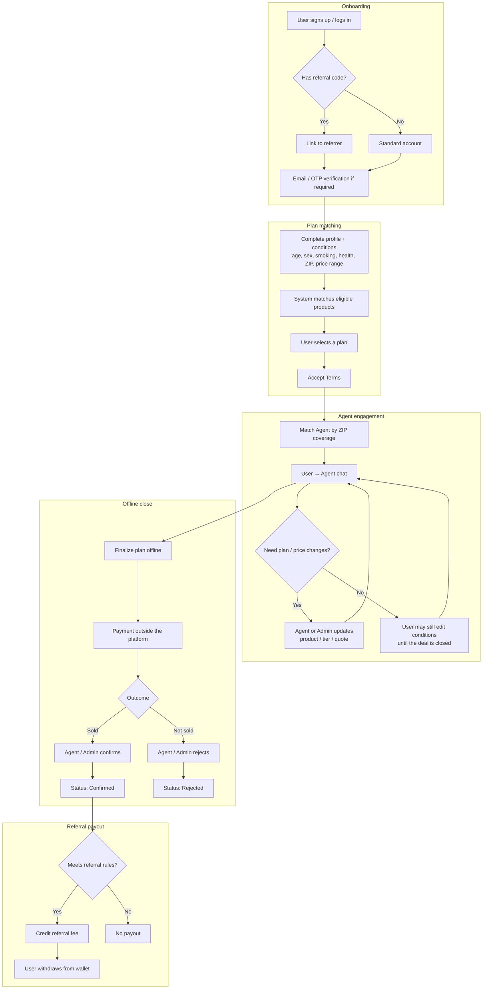

# To-App Business Flow

## Short summary

1. Sign up → profile/conditions → match products → select plan → Terms
2. Chat with ZIP-matched Agent → adjust plan/price as needed
3. Pay offline → Confirm / Reject in-app
4. If referral qualifies → fee credited → withdraw from wallet

## Roles

| Role | Responsibility |
|------|----------------|
| User | Sign up, complete conditions, select plan, chat, refer others, withdraw |
| Agent | Serve ZIP territory, chat, adjust quote/product, confirm after offline payment |
| Admin | Manage products/agents/users, edit user plans, confirm/reject, CMS, reports |
